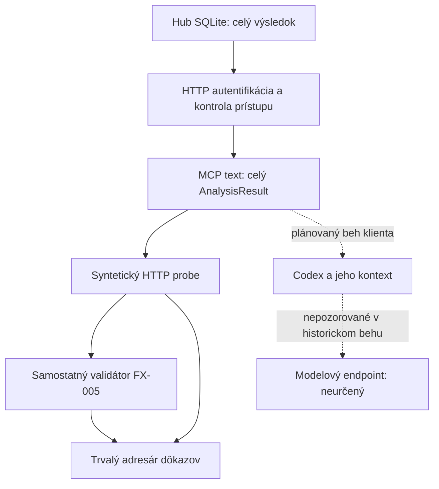

# FX-009 — mapa toku dát a hranica pred modelom

Dátum review: **21. 11. 2026 UTC**. Hodnotiteľ: koordinátorov agent pre FX-009. Rozsah: čítanie pripnutého kódu a už existujúcich záznamov; **bez nového behu servera, klienta alebo modelu a bez skutočných prípadových dát**.

| Podklad | Presná verzia |
| --- | --- |
| Produkt a integračný probe | `erikbabcan-commits/forenzx-analysis-brief`, commit `fb6b03f57297358381bf7b91ee7c811fc08146c6` |
| Produktový Git strom | `b7f8d40cf003f4a0b2610348e45574cde77232c9` |
| Hub | `erikbabcan-commits/forenzx-mcp-hub`, commit `0e4c7fae5944d44c1746ab3101acfbd70ab1ab8f` |
| Historická integračná evidencia | `docs/verification/fx007-live/report.json` a `docs/FX007_LIVE_VERIFICATION.md` v uvedenom produktovom commite |

## Výsledok review

**Mapa súčasnej implementácie je doložená zdrojmi. FX-009 tým nie je uzavretá a skutočné vstupy nie sú povolené.** Aktuálna cesta Hub → MCP klient odovzdáva celý výsledok bez zaradenia produktového validátora pred klienta. Samostatná kontrola výsledku v probe je neskoršia paralelná kontrola; nebráni klientovi načítať nekontrolovaný výsledok vlastným MCP volaním. [P2] [P3] [H1]

Zo zdrojov vieme určiť uloženie výsledku v Hube, HTTP cestu, konfiguráciu dvoch nástrojov a artefakty syntetického testu. Nevieme doložiť konkrétny model, modelový endpoint, jeho retenčné podmienky, spracovanie histórie ani zákaz prechodu na iného poskytovateľa. **Vlastný Hub, loopback HTTP, stdio ani prepínač `--ephemeral` samy osebe nedokladajú lokálne spracovanie modelom alebo nulovú retenciu.** Toto je hranica dôkazu zo skúmaných súborov, nie tvrdenie, že sa v historickom neúspešnom behu dáta modelu odoslali. [P1] [P3] [P5]

Historický report uvádza 13/13 priamych HTTP kontrol a zlyhanie Codexu pred prvou MCP požiadavkou. Aktuálny review tieto skúšky neopakoval. **Historické HTTP PASS, chyba lokálneho úložiska Codexu a neoverený prenos k modelu zostávajú samostatné zistenia.** [P5] [P6]

## 1. Súčasný tok a presné hranice

Plné šípky vyjadrujú cestu doloženú implementáciou; HTTP probe má aj historický záznam behu. Prerušované šípky vyjadrujú nakonfigurovanú alebo predpokladanú nadväzujúcu cestu, ktorá sa pri doloženom zlyhaní Codexu neuskutočnila. Diagram neukazuje budúci renderer ani experimentálny exportný server. [P2] [P3] [P5] [H1] [H2]

| Etapa | Čo skutočne robí kód | Čo z toho nevyplýva |
| --- | --- | --- |
| Zdrojový výsledok | `job_manager.store_result()` ukladá `AnalysisResult.model_dump_json()` do `job_results.result_json`; `get_result()` načíta uložený objekt cez Pydantic model. [H2] | Pydantic načítanie nie je produktová kontrola úplnosti transportu, dôveryhodnosti zdrojov ani modelového kontextu. |
| Vstup HTTP | `/mcp` vyžaduje autentifikáciu a dispatchuje požiadavku; vetva status/results pred čítaním vykonáva kontrolu prístupu k jobu. [H1] [H3] | Autentifikácia sama neobmedzuje následné využitie údajov klientom; podrobná matica oprávnení patrí FX-008. |
| Výsledok nástroja | `forenzx_analysis_results` vracia celý `AnalysisResult.model_dump(mode="json")`; dispatcher ho serializuje do `content[].text`. [H1] | Pred serializáciou sa nevolá `product/validate_input.py`, budúci renderer ani filter obsahu pre LLM. |
| Pozorovacia vrstva probe | `Recorder` prepúšťa ASGI správy bez zmeny; vyberá metadata a hashe do záznamu. [P2] | Nie je to validačná brána ani filter dát odovzdaných klientovi. |
| Kontrola FX-005 | Probe uloží HTTP výsledok a spustí nad ním samostatný validátor. Validátor ponecháva `report_generation_allowed: false`. [P2] [P4] | Prípadný následný Codex číta Hub vlastnými volaniami. Úspech predchádzajúcej samostatnej kontroly nezabezpečuje identickú snímku ani bránu na tejto klientovej ceste. |
| Konfigurácia klienta | Probe nastaví loopback HTTP endpoint, token z dočasnej premennej a klientsky zoznam status/results. Zaznamená verziu Codex CLI. [P3] | Nie je zaznamenaný presný model/provider/endpoint ani politika jeho histórie, telemetrie a retencie. Pokyn nepoužiť shell/web nie je dôkaz technického vypnutia týchto možností hostiteľa. |
| Model a uchovávanie klientom | V zachytenom historickom behu sa Codex zastavil pred MCP. [P5] | Spracovanie reálnym modelom, odoslaný kontext, jeho úplnosť a lokálne či vzdialené uchovávanie nie sú overené. |

### Zistenie FX009-F01 — chýba vynútenie pred prvým odovzdaním klientovi

Produktový kontrakt vyžaduje kontrolu pred modelom. Dnešný probe má dve oddelené operácie: samostatne validuje predtým načítaný súbor a potom spúšťa klienta priamo proti Hube. Zdrojové komentáre túto hranicu už správne pomenúvajú. Za úspech FX-009 sa preto nesmie započítať samotné `STRUCTURE_VALID`. [P1] [P2] [P4]

Navrhované doplnenie: kontrolovaný adaptér, ktorý získa povolenú snímku, vykoná potrebné kontroly a až potom vydá schválený výstup spoločného jadra. Pri chybe môže klient dostať iba diagnostiku bez odmietnutého prípadového obsahu. Priamy nástroj na čítanie surového výsledku nesmie obchádzať túto hranicu v deklarovanej reportovacej konfigurácii. Ide o **integračnú požiadavku**, nie o implementáciu dokončenú týmto dokumentom.

### Zistenie FX009-F02 — profil modelu nie je identifikovaný

`run_codex()` explicitne konfiguruje MCP, schému odpovede a režim CLI. V reporte uvádza verziu klienta, endpoint Hubu, názov premennej tokenu a nastavenia nástrojov. Neuvádza model, jeho poskytovateľa, skutočný modelový endpoint, kontextový rozpočet, tréningové nastavenie ani retenciu. Proces dedí prostredie cez `dict(os.environ, ...)`; obsah prostredia sa v tomto review nečítal ani nevypisoval. [P3]

Z prepínačov `--ignore-user-config`, `--ephemeral` a `--sandbox read-only` sa tu neodvodzuje vlastnosť vzdialenej služby. Názvy prepínačov nie sú dôkazom neukladania údajov poskytovateľom. Rovnako neexistuje doložený test, že chyba primárneho modelového endpointu zastaví tok bez použitia iného poskytovateľa. **ZDR, lokálny model, vypnutý tréning a zákaz fallbacku zostávajú pri tejto konfigurácii neurčené alebo neoverené.** [P1] [P3] [P5]

### Zistenie FX009-F03 — stdio nie je samostatná záruka súkromia

Pripnutý Hub má vlastnú `run_cli_stdio()` vetvu. Tá vytvára lokálneho používateľa s rolami `admin` a `analyst`; nie je to experimentálny exportný server s reportovacím oprávnením. Zároveň volá startup logger a zdieľaný logger používa `sys.stdout`. Pri budúcom stdio overení treba osobitne preveriť oddelenie protokolu od logov. Toto review stdio nespúšťalo. [H3] [H4]

Bez ohľadu na transport medzi serverom a klientom treba samostatne určiť cestu klient → model. Ani správne lokálne stdio nevynucuje, kam hostiteľský klient pošle prijaté nálezy. V tomto rozsahu sa netvrdí úplná offline prevádzka. [P1]

## 2. Kde ostávajú údaje a poverenia

| Miesto | Obsah doložený kódom | Životnosť a obmedzenie dôkazu |
| --- | --- | --- |
| Hub databáza | Celý výsledok, identity job/case/evidence, stav, vlastník, organizácia a chybový text. SQLite používa WAL. [H2] [H5] | Súčasť vlastnej inštancie; jednotná retenčná politika pre tieto dáta v skúmanej reportovacej ceste nie je doložená. Zahrnúť aj WAL a zálohy. |
| Hub zálohy | `backup_database()` vytvára konzistentnú kópiu SQLite a manifest s hashom. [H6] | Kópia má samostatnú životnosť. Vymazanie aktívneho záznamu samo nepreukazuje odstránenie jeho záložných kópií. |
| Hub logger | JSON správy, výnimky, doplňujúce polia, prípadne user/case/job ID; vytvorenie jobu loguje identifikátory. [H2] [H4] | Formatter nemá všeobecné maskovanie tajomstiev alebo prípadového obsahu; konečná retencia závisí aj od zachytávača stdout nasadenia. Netvrdí sa, že každé čítanie loguje celý nález. |
| Registry udalosti | Nastavenie `maintenance_event_retention_days` má výchoziu hodnotu 30; `prune_events()` maže iba `registry_events`. [H6] [H7] | **Nie je to 30-dňová retencia celého Hubu**, job výsledkov, záloh, klienta alebo modelu. Samotné nastavenie ani nedokladá vykonanie údržby. |
| Dočasný FX007 priestor | Vlastná databáza, dátové adresáre, dočasný pracovný adresár klienta a súbory testu. Náhodné poverenia sa poskytnú subprocessom prostredím. [P2] | `TemporaryDirectory` a cleanup spravujú tento vytvorený priestor a vlastné procesy. Tým sa nedokladá výmaz iných úložísk klienta alebo poskytovateľa. |
| Trvalý adresár FX007 reportu | `seeded-result.json`, `retrieved-result.json`, validačný report, prompt, príkaz, klientské events/stderr/final, serverový log a HTTP metadata. [P2] [P3] | Zámerne pretrvávajú po teste; uložené historické exempláre sú aj v Gite. Obsah príkladov je od začiatku syntetický. Nie je to režim pre skutočné prípady. |
| História a diagnostika AI klienta | Probe pozná vlastné výstupné súbory a zvolený režim CLI. [P3] | Umiestnenie a retencia všetkého interného klientského stavu neboli týmto kódom ani review doložené. |
| Modelový endpoint | V hodnotenej konfigurácii neidentifikovaný. [P3] | Retencia požiadaviek/odpovedí, diagnostika, tréning, geografická cesta a prípadný ďalší spracovateľ nie sú doložené. |

### Poverenia a rozsah sanitizácie testu

Šablóna pre zákazníka obsahuje iba zástupný endpoint a názov premennej pre bearer token. Probe generuje vlastné krátkodobé syntetické poverenia. `redact()` nahrádza konkrétne vygenerované hodnoty a bearer reťazce; pozorovací log zámerne neukladá Authorization, cookies ani ostatné argumenty nástrojov. [P2] [P3] [P7]

Táto sanitizácia **nie je anonymizácia ľubovoľného forenzného výstupu**. Plné syntetické nálezy sa zámerne ukladajú a stdout/final klienta by pri úspešnom behu mohli obsahovať zdrojový text. Prenesenie probe na reálne údaje bez zmeny jeho kontraktu by preto vytvorilo nové kópie prípadových dát. V tomto review sa taký beh nevykonal. [P2] [P3]

Hash odpovede, hash kanonického objektu a hash uloženého vstupu identifikujú rozdielne reprezentácie. Nepotvrdzujú pôvodnú autenticitu dôkazu, úplnosť upstream analýzy ani odstránenie údajov. Validátor tieto hranice pomenúva ako `NOT_VERIFIED` a `RECEIVED_JSON_ONLY`. [P2] [P4]

## 3. Minimálny záznam podporovanej konfigurácie

Pred povolením prvého skutočného vstupu musí konkrétna konfigurácia dostať verziovaný záznam. Nasledujúce polia sú návrh požiadavky; nevypĺňajú sa odhadom a neobsahujú hodnoty poverení.

| Oblasť | Povinný obsah záznamu |
| --- | --- |
| Zdroj | Presný Hub build/commit, schémový profil, povolený endpoint a spôsob overenia jeho identity; oddeliť verziu servera, packu a MCP protokolu. |
| Rozsah prístupu | Použitý typ poverenia a jeho vynútené oprávnenia; povolené job/case/evidence identity; rozhraním dostupné nástroje. Hodnotu tokenu neukladať. |
| Kontrolovaný adaptér | Verzia/commit, umiestnenie, politika, prijatá bajtová snímka, pravidlá úplnosti, výstup a chybové chovanie pred odovzdaním klientovi. |
| AI klient | Názov a verzia, konfigurácia nástrojov, dostupné ďalšie nástroje, práce s históriou, diagnostikou a telemetriou; čo vynucuje klient a čo prostredie. |
| Model | Presný model, provider a endpoint; pri lokálnej variante runtime, identita váh a pridelený kontext. Označenie „lokálny“ musí zodpovedať pozorovanému toku. |
| Kontext a výstup | Nameraný rozpočet celej konfigurácie vrátane pokynov, nástrojov, histórie a rezervy výstupu; spôsob odhalenia skrátenia a nedokončeného výstupu. |
| Ukladanie | Každý cieľ uloženia, správca, prístup, retencia a postup výmazu vrátane záloh; zvlášť poskytovateľ, klient a lokálny report. |
| Nastavenie poskytovateľa | Doložené podmienky konkrétnej služby a účtu: retencia, použitie na tréning, telemetria a prípadné ZDR. Nezamieňať jednu vlastnosť s druhou. |
| Presuny a výpadok | Doložené povolené ciele; pri chybe žiadny automatický prenos inému poskytovateľovi. Spôsob vynútenia a negatívny test. |
| Rozhodnutie a evidencia | Vlastník konfigurácie, schválený rozsah údajov, dátum, dôkazy syntetického overenia a obmedzenia; zmena konfigurácie vyvolá nové posúdenie. |

Položky vychádzajú z aktuálneho kontraktu a brán kvality. Neustanovujú právny záver o konkrétnom nasadení; ani budúce ZDR nebude samo osebe certifikáciou spracovania alebo splnenia všetkých povinností. [P1] [P8]

## 4. Akceptačná matica FX-009

Stav nižšie je hodnotenie podmienky **k tomuto review**. Návrh testu nie je vykonaný test. `FAIL` pri F09-02 označuje chýbajúce vynútenie doložené zdrojom, nie nový neúspešný modelový beh.

| ID | Podmienka a konkrétne overenie | Aktuálny stav | Potrebný dôkaz / vlastník |
| --- | --- | --- | --- |
| F09-01 | Zmapovať zdroj, transport, klienta, model a ukladanie; neznáme časti výslovne označiť. | **PASS — zdrojové review** | Tento dokument a pripnuté súbory. Koordinátor; nezatvára celú FX-009. |
| F09-02 | Odmietnutý alebo neúplný vstup sa nedostane do výsledku MCP nástroja určeného klientovi/modelu. Syntetický sentinel v odmietnutej vetve musí chýbať na prijímacom bode. | **FAIL — kontrola nie je v tejto ceste** | Implementácia kontrolovaného adaptéra a negatívny integračný záznam s pozorovaním výstupu. Koordinátor integrácie / FX-005. |
| F09-03 | Pomenovať presnú podporovanú kombináciu klient, model, provider, endpoint, kontext a politika ukladania. | **BLOCKED — profil nie je doložený** | Verziovaný konfiguračný záznam bez tajomstiev a overenie reálneho klienta. FX-007/009/016. |
| F09-04 | Pred prvým načítaním reálnych výsledkov odmietnuť neznámu či zmenenú konfiguráciu; dôvod musí byť zrozumiteľný pred prenosom. | **NOT_TESTED** | Negatívne testy zmeny endpointu/modelu/profilu, chýbajúcich hodnôt a neplatného schválenia. Koordinátor integrácie. |
| F09-05 | Simulovaný výpadok schváleného modelového endpointu neodošle obsah inému poskytovateľovi. | **NOT_TESTED** | Syntetický test na pozorovanom prijímacom bode alebo v schválenom prostredí s doloženým obmedzením siete; žiadny tichý fallback. Vlastník konfigurácie. |
| F09-06 | Klient nemôže obísť adaptér priamym čítaním surového výsledku alebo vykonaním start/cancel pod reportovacím poverením. | **NOT_TESTED pre budúci adaptér; aktuálny Hub report-only zákaz nesplnil** | Samostatný nový [runtime dôkaz FX-008](FX008_AUTHORIZATION_REVIEW.md) ukázal skutočný cancel a prechod start ACL. Budúci adaptér potrebuje serverovú politiku a negatívne integračné testy; klientsky zoznam nástrojov nestačí. |
| F09-07 | Zachovanie všetkých warnings/limitations a schválených zdrojových údajov až po posledný záznam; žiadne tiché orezanie v klientovi/modeli. | **NOT_TESTED v celom toku** | Zmeraný kontextový profil, hraničný syntetický vstup a strojové porovnanie obsahu. Lokálny byte limit to nenahrádza. FX-005/010–014. |
| F09-08 | Syntetické tajomstvá sa neobjavia v diagnostike, príkazoch ani chybách. Prípadový sentinel sa ukladá iba do vopred uvedených cieľov. | **NOT_TESTED pre budúci produktový tok** | Pozitívny a chybový test určeného adaptéra/klienta, inventár súborov a retenčný záznam. Súčasná sanitizácia probe je užší mechanizmus. FX-009/015. |
| F09-09 | Lokálna/offline/ZDR tvrdenia sa vydávajú iba pre konkrétny overený rozsah; tréning a retencia sú uvedené samostatne. | **BLOCKED — žiadny schválený profil** | Dokumentácia konkrétnej služby a konfigurácie plus príslušný technický test; bez takých dôkazov tvrdenia nepoužiť. FX-009/017. |
| F09-10 | Zdrojové odkazy a texty nezapríčinia ďalšie neplánované načítanie alebo odoslanie. Deterministický výstup sa stále považuje za nedôveryhodný obsah. | **NOT_TESTED v modelovom toku** | Oddelené testy renderovania a modelovej odolnosti; sentinel URL nesmie byť automaticky otvorená. FX-010/014. |

Pre F09-02 až F09-08 možno najprv použiť lokálny syntetický prijímací test bez plateného modelu. Dokazuje presne hranicu, ktorú pozoruje; nenahrádza následný test deklarovaného klienta a modelu. Žiadny z týchto testov nepotrebuje reálny dôkazový materiál.

## 5. Odporúčaný najbližší krok

**Koordinátor má vytvoriť konkrétny integračný kontrakt kontrolovaného adaptéra a jeho testovacieho prijímacieho bodu.** Vstup musí byť explicitne povolená syntetická snímka, výstup musí rozlišovať kontrolované zdrojové údaje a bezpečnú diagnostiku. Prístup k surovému Hub výsledku sa nesmie objaviť ako obchádzka tejto cesty v podporovanej reportovacej konfigurácii.

Tento krok môže prebiehať súbežne s Codexovým rendererom, bez druhého renderera a bez zmien jeho súborov. Po odovzdaní spoločného jadra sa jeho výstup zapojí do adaptéra. Presný modelový profil sa doplní pri funkčnom klientskom teste FX-007; dovtedy zostávajú modelové a produkčné tvrdenia otvorené.

Tento review nemení backlog, live dashboard, práva servera ani oprávnenie používať reálne dáta. Neobsahuje rozhodnutie o licencii, nasadenie ani odoslanie správy.

## Zdroje pripnuté ku kódu

Odkazy na súkromný produktový repozitár vyžadujú existujúci prístup vlastníka. Označenie PASS sa opiera iba o uvedený rozsah dôkazu; historické reporty sa neprezentujú ako nové výsledky.

[P1]: https://github.com/erikbabcan-commits/forenzx-analysis-brief/blob/fb6b03f57297358381bf7b91ee7c811fc08146c6/docs/PRODUCT_CONTRACT.md "P1 — produktový kontrakt, najmä Tok dát a Dátový kontrakt"
[P2]: https://github.com/erikbabcan-commits/forenzx-analysis-brief/blob/fb6b03f57297358381bf7b91ee7c811fc08146c6/integration/fx007/run_probe.py "P2 — Recorder 102–166, setup 319–364, výstupy a validátor 408–460, cleanup 487–500"
[P3]: https://github.com/erikbabcan-commits/forenzx-analysis-brief/blob/fb6b03f57297358381bf7b91ee7c811fc08146c6/integration/fx007/run_probe.py#L225-L292 "P3 — konfigurácia, prompt a uložené výstupy Codexu"
[P4]: https://github.com/erikbabcan-commits/forenzx-analysis-brief/blob/fb6b03f57297358381bf7b91ee7c811fc08146c6/product/validate_input.py#L375-L417 "P4 — výsledok validátora, hranice dôkazu a report_generation_allowed false"
[P5]: https://github.com/erikbabcan-commits/forenzx-analysis-brief/blob/fb6b03f57297358381bf7b91ee7c811fc08146c6/docs/verification/fx007-live/report.json "P5 — historický strojový report FX007, žiadny nový beh"
[P6]: https://github.com/erikbabcan-commits/forenzx-analysis-brief/blob/fb6b03f57297358381bf7b91ee7c811fc08146c6/docs/FX007_LIVE_VERIFICATION.md "P6 — rozsah historického HTTP úspechu a samostatné zlyhanie klienta"
[P7]: https://github.com/erikbabcan-commits/forenzx-analysis-brief/blob/fb6b03f57297358381bf7b91ee7c811fc08146c6/integration/fx007/codex-config.example.toml "P7 — zákaznícka konfiguračná šablóna a hranica klientského zoznamu nástrojov"
[P8]: https://github.com/erikbabcan-commits/forenzx-analysis-brief/blob/fb6b03f57297358381bf7b91ee7c811fc08146c6/docs/QUALITY_GATES.md "P8 — technické a jazykové kontroly, kontext a model dôkazu"
[H1]: https://github.com/erikbabcan-commits/forenzx-mcp-hub/blob/0e4c7fae5944d44c1746ab3101acfbd70ab1ab8f/core/server.py#L221-L313 "H1 — oprávnenia čítania, celé results a serializácia MCP textu"
[H2]: https://github.com/erikbabcan-commits/forenzx-mcp-hub/blob/0e4c7fae5944d44c1746ab3101acfbd70ab1ab8f/core/jobs.py#L100-L189 "H2 — uloženie a načítanie výsledku, status a logovanie job ID"
[H3]: https://github.com/erikbabcan-commits/forenzx-mcp-hub/blob/0e4c7fae5944d44c1746ab3101acfbd70ab1ab8f/core/main.py "H3 — /mcp 227–248, stdio 495–508"
[H4]: https://github.com/erikbabcan-commits/forenzx-mcp-hub/blob/0e4c7fae5944d44c1746ab3101acfbd70ab1ab8f/core/utils/logger.py#L17-L67 "H4 — obsah JSON logu a stdout handler"
[H5]: https://github.com/erikbabcan-commits/forenzx-mcp-hub/blob/0e4c7fae5944d44c1746ab3101acfbd70ab1ab8f/core/db.py "H5 — SQLite WAL a ukladanie udalostí"
[H6]: https://github.com/erikbabcan-commits/forenzx-mcp-hub/blob/0e4c7fae5944d44c1746ab3101acfbd70ab1ab8f/core/maintenance.py "H6 — backup_database 33–80 a prune_events 129–134"
[H7]: https://github.com/erikbabcan-commits/forenzx-mcp-hub/blob/0e4c7fae5944d44c1746ab3101acfbd70ab1ab8f/core/config.py#L20-L47 "H7 — cesty a nastavenie retencie udalostí"

## Overenie z 22. novembra 2026

[Aktuálne výsledky, testované revízie a otvorené podmienky](FX_AUDIT_2026-11-22.md).
